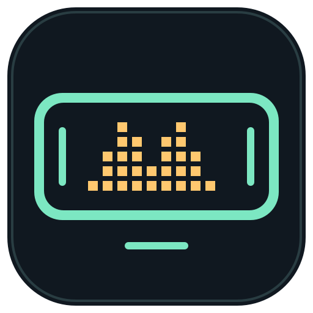
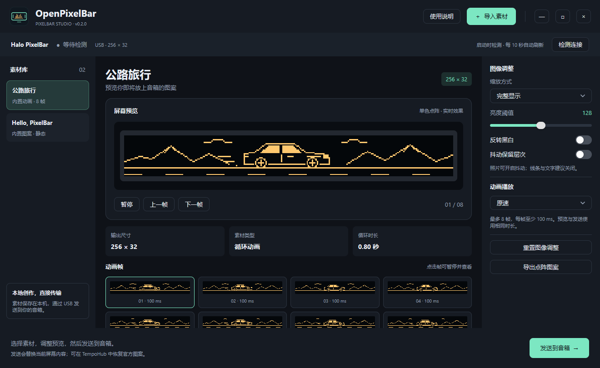

# OpenPixelBar

给花再 **Halo PixelBar** 音箱的屏幕，放上你自己的图片和动画。

OpenPixelBar 是使用 **Go + MyGo Native UI** 编写的独立桌面工具，通过 USB HID 与音箱通信。无需运行 TempoHub，不依赖 Python 或 WebView。当前开发版本：**v0.2.0**。

> **重要免责声明**
>
> 本项目是独立开发的非官方工具，与 EDIFIER（漫步者）及花再不存在隶属、授权、合作或背书关系。
>
> **使用本程序存在风险，包括但不限于显示异常、设置或内容丢失、设备无法正常工作、音箱损坏。因使用本程序造成音箱损坏，作者及贡献者概不负责。**
>
> 本程序按“现状”提供，不承诺安全性、稳定性、适用性或兼容性。在适用法律允许的范围内，作者及贡献者不承担因使用、误用或无法使用本程序造成的直接或间接损失，也不承担维修、更换设备或赔偿责任。请自行评估并承担使用风险；如果不能接受这些风险，请勿使用。
>
> **目前仅测试了 Halo PixelBar 固件 1.1.1。测试成功不代表其他设备、固件或使用环境同样安全，也不保证已测试环境绝不会发生故障。**

## 应用截图



主界面展示内置“公路旅行”动画，可在同一窗口选择素材、预览效果、调整图像并导出或发送到音箱。

## 下载 v0.2.0 预发布版

请先阅读上述免责声明。解压 Windows 压缩包后运行 `OpenPixelBar.exe`；Mac 包仅供实机测试，未完成 Developer ID 签名或 Apple 公证。

| 平台 | 下载 | 状态 |
| --- | --- | --- |
| Windows x64 | [Windows 便携包](https://github.com/trlanfeng/OpenPixelBar/releases/download/v0.2.0/OpenPixelBar-v0.2.0-windows-amd64.zip) | 已在下述 Windows 环境实测 |
| macOS Apple Silicon | [arm64 测试包](https://github.com/trlanfeng/OpenPixelBar/releases/download/v0.2.0/OpenPixelBar-v0.2.0-macos-arm64.zip) | 尚未实机验证 |
| macOS Intel | [amd64 测试包](https://github.com/trlanfeng/OpenPixelBar/releases/download/v0.2.0/OpenPixelBar-v0.2.0-macos-amd64.zip) | 尚未实机验证 |

[Release 页面](https://github.com/trlanfeng/OpenPixelBar/releases/tag/v0.2.0) · [SHA-256 校验文件](https://github.com/trlanfeng/OpenPixelBar/releases/download/v0.2.0/SHA256SUMS.txt)

## 已测试版本与范围

以下为 **2026-11-12** 的实际验证记录，未测试的部分不作兼容性承诺。

| 项目 | 版本 / 环境 | 验证情况 |
| --- | --- | --- |
| 音箱型号 | 花再 Halo PixelBar | 仅本机这台设备完成 USB 实测；不代表其他型号 |
| 音箱固件 | **1.1.1** | 已验证连接、协议回复、动画上传及上传后场景确认；程序拒绝其他固件版本 |
| USB 设备 | VID `2D99` / PID `A160`；usage page `FF14` | 已验证控制接口，64 字节 HID 报文 |
| Windows | **Windows 11 专业版 x64，10.0.26300 / Build 26300** | 已验证窗口启动、图像预览、应用内弹框、启动检测与每 10 秒检测，以及 Go 版汽车 GIF 上传 |
| OpenPixelBar | **v0.2.0 开发版** | 当前 Go/MyGo 实现；协议、图像、格式校验和界面自动测试通过 |
| macOS Apple Silicon | `arm64` 构建 | **仅交叉编译及应用包检查通过，未在 Mac 实机验证界面或 USB 上传** |
| macOS Intel | `amd64` 构建 | **仅交叉编译及应用包检查通过，未在 Mac 实机验证界面或 USB 上传** |
| 其他 Windows / 音箱 / 固件 | — | **未测试** |

验证细节：

- 静态“HELLO, PixelBar!”图案在早期 Python 版中实机上传成功，用户已目视确认正常显示。
- Go 版已实机上传内置 8 帧小汽车动画，收到最终接收确认，并查询到动画场景 `01 06 34`；编码与早期已验证数据逐字节一致。实际动画观感仍以音箱实物为准。
- 构建环境：Go **1.27.4**，MyGo **v0.9.0**；源码最低要求 Go **1.27.3**。
- macOS 应用包声明的最低系统版本为 **12.0**，这只是构建配置，**不等于 macOS 12 已通过测试**。Mac 测试包没有 Developer ID 签名或 Apple 公证。
- 尚未验证音箱断电后的内容保留、长期连续运行稳定性、不同批次设备和其他固件。

## 功能

- 自绘深色标题栏和窗口按钮，支持拖动、最小化、最大化/还原。
- 顶部“图片模式 / 文字模式 / 颜色设置”标签；切换标签保留图片和文字各自的预览与播放位置。
- 文字模式支持选择常用系统字体或载入 TTF / OTF / TTC、8～32 px 字号、静态 / 上下移动 / 左右移动，生成点阵图片后预览、导出和发送。
- 颜色设置支持调色板、RGB 滑块和常用色，调色板选中色与 RGB 双向同步；启动与每 10 秒检测时读取音箱颜色，同步图片和文字预览。颜色写入后回读核对，确认前不显示成功。
- 素材列表、连续像素预览、播放/暂停和逐帧查看；内置公路旅行汽车动画。
- 完整显示、铺满裁切、拉伸填满，以及阈值、反色和抖动处理。
- 动画速度调整，导出处理后的 PNG 或循环 GIF。
- 顶部设备状态栏：启动时检测一次，之后每 10 秒后台检测；上传期间跳过检测，避免 USB 冲突。
- 导入弹框列出格式、限制和免责声明；文件扩展名与真实图片格式双重校验。
- 逐包确认、最终接收确认与屏幕场景核对；错误会在界面中显示。

## 支持的素材

| 类型 | 扩展名 | 处理方式 |
| --- | --- | --- |
| 静态图片 | `.png`、`.jpg`、`.jpeg`、`.bmp`、`.webp` | 转换为 256 × 32 单色点阵 |
| GIF 动画 | `.gif` | 支持 1～8 帧、透明合成和帧处置；多帧循环播放 |

- 单文件最大 **32 MB**，全部帧合计不超过 **4000 万像素**。
- GIF 每帧至少 **100 ms**；更短时长会调整到 100 ms。超过 8 帧会报错，不会静默丢帧。
- 除 GIF 外，其他格式按静态图片处理；不提供动画 WebP / APNG 播放支持。
- JPEG 支持 EXIF 方向校正；透明区域按黑色背景处理。
- 改扩展名不能转换文件格式；扩展名与实际格式不一致的文件会被拒绝。
- 音箱屏幕是 **256 × 32 单色点阵**，不能保留照片原色。图片和文字发送后沿用音箱当前屏幕颜色；连接后预览采用读取到的 RGB。读取失败时会注明使用模拟色或上次读取值，实际亮度与观感以音箱为准。

## 使用方法

1. 通过 USB 连接 Halo PixelBar，切换到声卡输入，退出 TempoHub，避免同时访问设备。
2. Windows 双击 `dist/OpenPixelBar.exe`。Mac 解压对应架构的测试包，打开 `OpenPixelBar.app`。
3. 查看顶部设备状态；程序会自动检测，也可以点击“检测连接”。
4. 点击“导入素材”，阅读格式说明和免责声明，再点击弹框中间的“选择图片或 GIF”。
5. 调整图案并查看预览；动画可以暂停、逐帧检查和调整速度。
6. 点击“发送到音箱”，等待完成确认，再检查音箱实物显示。

**发送会替换当前屏幕内容和对应图案场景槽位。** 需要恢复官方图案时，在 TempoHub 中重新选择并发送。程序不刷写固件，但这不构成设备安全保证。

使用说明也可从应用右上角的“使用说明”弹框查看。请只导入你拥有使用权的图片或动画。

### 文字模式与颜色设置（当前源码构建）

- **文字模式**：输入 1～80 字的单行文字，选择字体、字号、动画方式和每帧时长，再点击“生成预览”。预览、PNG / GIF 导出与上传使用相同点阵帧；参数修改或生成失败后须重新生成，不能发送旧预览。
- 常用系统字体由本机提供，不随程序分发。也可载入不超过 64 MB 的 `.ttf`、`.otf`、`.ttc` 字体文件；字体集合使用第一个字面。不支持的字符会明确报错，请改用包含相应字形的字体。
- 静态文字生成 1 帧；动画生成 8 帧往返移动，每帧可设为 100～2000 ms。长文字可选择左右移动，但受 8 帧限制步幅较大；上下移动可能经过屏幕边缘。无法容纳的文字会报错，需缩短内容或减小字号。
- **颜色设置**：可在调色板拖动选择饱和度与亮度，用下方色相条选择色相；也可调整 RGB 滑块。两者及常用色、恢复操作会同步更新选中色与 RGB 数值，调色板支持方向键微调。选好后点击“应用颜色到音箱”。未应用的草稿不会改变图片与文字预览，后台读取也不会覆盖调色草稿。“恢复为已读取颜色”可撤销草稿。设置黑色会让亮点不可见。
- 颜色通过独立 RGB 指令设置，回读时同时核对其他屏幕设置未改变；发生错误不自动重试。检测、上传和颜色写入共用任务互斥，避免同时访问 USB。
- **2026-11-12 验证**：在上述 Windows / Halo PixelBar 固件 1.1.1 环境完成颜色实机读取；文字生成、标签交互、颜色写入确认和失败分支完成自动测试。**新增文字上传和颜色修改尚未进行实机写入与用户目视验证**；Mac 仍仅完成交叉构建与包检查。这些功能未另行发布到上方 v0.2.0 下载包。

### 本地数据

- 图片不会上传到网络；素材通过本地 USB 发送。
- 素材列表只记录原文件路径，不复制原图。原文件移动或删除后需重新导入。
- Windows 设置：`%APPDATA%/OpenPixelBar/settings.json`。
- macOS 设置：`~/Library/Application Support/OpenPixelBar/settings.json`。
- 首次以新名称运行时，会尝试读取旧 `OpenPB` 目录下的设置，后续保存到 `OpenPixelBar` 目录。

## 从源码构建

需要 **Go 1.27.3+**，无需 C 编译器。首次构建需要联网下载依赖；依赖版本记录在 `go.mod` 和 `go.sum`。Windows 资源生成工具固定为 `go-winres v0.3.3`。默认 Go 代理不可达时，可自行配置 `GOPROXY`。

### Windows x64

```powershell
./scripts/build-windows.ps1
```

输出：`dist/OpenPixelBar.exe`，包含应用图标、Windows 清单和版本信息。

### macOS

在 Windows 上生成两种架构的测试包：

```powershell
./scripts/build-macos.ps1
```

输出：

- `dist/OpenPixelBar-macos-arm64.zip`：Apple Silicon。
- `dist/OpenPixelBar-macos-amd64.zip`：Intel。

在 Mac 上构建并进行本地 ad-hoc 签名：

```sh
sh scripts/build-macos.sh arm64   # Intel 使用 amd64
```

本地 ad-hoc 签名不等于 Developer ID 签名或 Apple 公证。正式分发前仍应完成 Mac 实机验证和签名流程。

### 开发与验证

```sh
go run ./cmd/openpixelbar
go test ./...
go vet ./...
```

只检测设备并读取当前屏幕 RGB：`go run ./cmd/openpixelbar --check`。

直接在界面打开素材：`go run ./cmd/openpixelbar path/to/image.png`。

`go run ./cmd/openpixelbar --upload path/to/image.gif` **会实际向音箱发送图案**，使用前请阅读免责声明。

自动测试覆盖协议位序、记录编号、校验和、失败响应、最终确认、场景核对、图像比例、透明度、GIF 合成、帧数限制、文件格式校验、弹框、播放控制、像素接缝与设备检测调度。自动测试不能替代实机验证。

## 图标与目录

图标为原创的“音箱 + 像素波形”矢量设计：

- [SVG 源文件](internal/branding/icon.svg)
- [PNG 图标](internal/branding/icon.png)
- [Windows ICO](internal/branding/icon.ico)
- [macOS ICNS](internal/branding/icon.icns)

修改 SVG 后，运行 `go run ./cmd/generate-icon` 重新生成平台图标，再运行构建脚本。

| 路径 | 用途 |
| --- | --- |
| `cmd/openpixelbar` | 桌面应用和诊断入口 |
| `internal/branding` | 项目名称、版本、图标与应用内免责声明 |
| `internal/studio` | MyGo 界面、素材管理和后台任务 |
| `internal/pixelbar` | 图像处理、协议、Windows / macOS HID 传输 |
| `packaging`、`scripts` | 图标资源、应用包和构建脚本 |
| 根目录 Python 文件 | 早期协议验证参考，新版运行无需 Python |

`research`、`.tools`、`build` 和 `dist` 是本地分析、工具链或构建输出，不纳入发布源码。第三方组件许可见 [THIRD_PARTY_NOTICES.txt](THIRD_PARTY_NOTICES.txt)。
